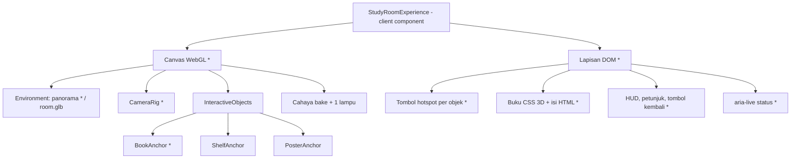
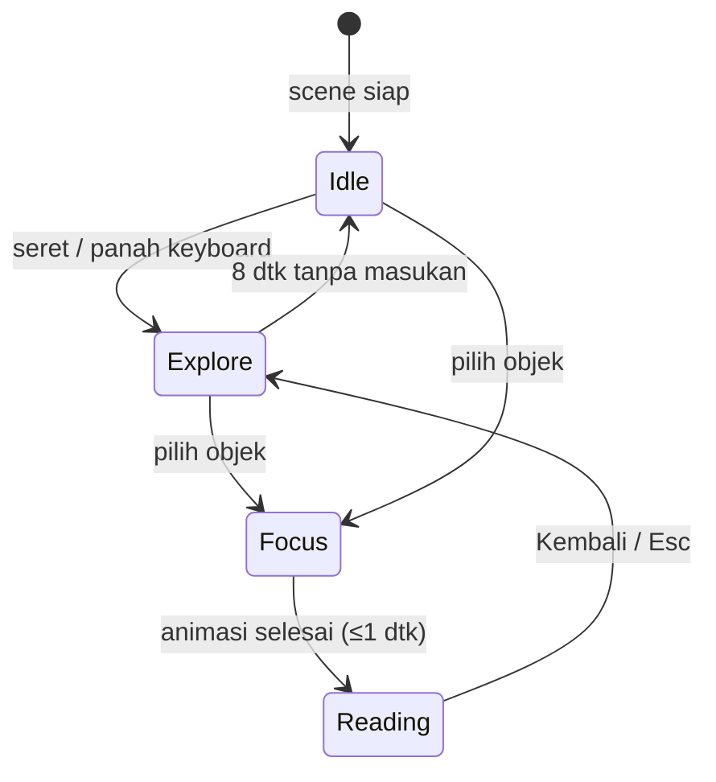
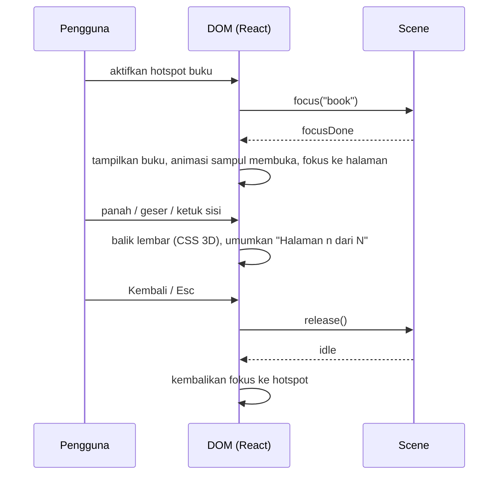
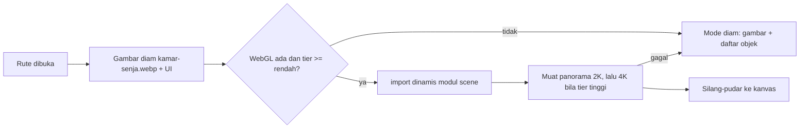
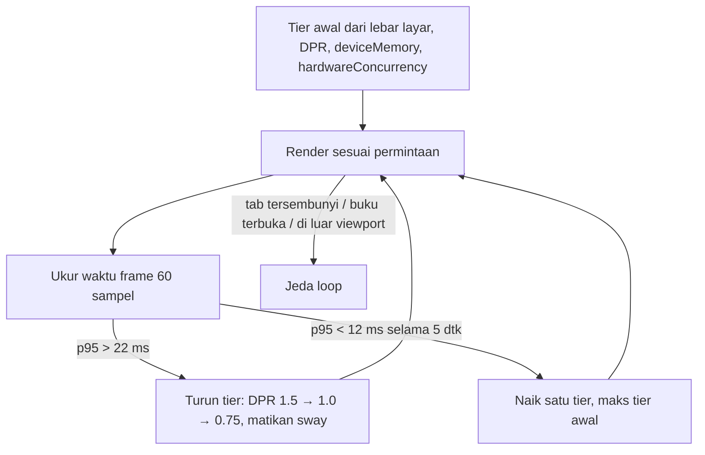

# Audit Pemulihan Pengalaman Imersif: Cinema dan Study Room

Tanggal audit: 2026-11-22. Cabang: `research/immersive-experience-recovery` (dari `origin/r005-migrasi-logika` @ `44d93f5`).
Lingkup: audit, instalasi skills, dan rencana teknis. Tidak ada kode fitur, dependensi runtime, migrasi, merge, atau deploy.

Konvensi: **[Terbukti]** = diperiksa langsung di berkas/riwayat/peramban. **[Inferensi]** = kesimpulan dari bukti tidak langsung. **[Tidak ditemukan]** = dicari dan tidak ada.

## 1. Ringkasan temuan

| Pertanyaan | Jawaban | Status |
|---|---|---|
| Apakah Cinema pernah diimplementasikan? | Ya, di `ata-prototype/index.html` (artefak Putaran 0). Dua lapis gambar WebP (latar + kursi depan) dengan parallax CSS/pointer dan layar slide DOM. | Terbukti, masih berjalan |
| Apakah Study Room pernah diimplementasikan? | Ya, di berkas yang sama. Panorama equirectangular digambar oleh shader WebGL buatan sendiri, kamera diseret, hotspot buku, kamera mendekat. | Terbukti, masih berjalan |
| Apakah buku 3D interaktif ada? | Ya, sebagai CSS 3D DOM (`.book3d`), bukan model 3D. Buka, balik halaman, dan miring berfungsi. Isi halaman adalah HTML asli. | Terbukti |
| Three.js / R3F / Drei? | Tidak pernah dipakai di kedua repo, di cabang mana pun. | Tidak ditemukan |
| Unreal Engine? | Tidak ada `.uproject`, `.uasset`, `.umap`, atau kode terkait di riwayat mana pun. | Tidak ditemukan |
| Sumber Blender / model 3D? | Tidak ada `.blend`, `.glb`, `.gltf`, `.fbx`, `.obj`, `.hdr`, `.exr`, `.ktx2`. Hanya hasil render WebP. | Tidak ditemukan |
| Apakah fiturnya "hilang"? | Tidak terhapus dari git. Fitur tertinggal di `index.html` lama saat prototipe ditulis ulang menjadi `app.html`, dan tidak pernah dimigrasikan ke aplikasi. | Terbukti (mekanisme), inferensi (niat) |
| `kamar-360.webp` benar 360°? | Ya, equirectangular 2:1 dengan sambungan kiri-kanan mulus. Resolusinya rendah (2048×1024). | Terbukti |

Konsekuensi utama: yang bisa dipulihkan adalah **perilaku dan gambar hasil render**, bukan scene 3D. Ruangan 3D yang sungguh bisa dijelajahi (paralaks nyata, objek yang bisa dipilih bebas) harus **dibangun ulang** dari nol karena sumber modelnya tidak ada di repo.

## 2. Struktur repository dan riwayat

| Repo | Cabang remote | Tag | Commit (semua ref) | Shallow | Git LFS |
|---|---|---|---|---|---|
| `ata` | `main`, `r005-migrasi-logika`, `claude/busy-hypatia-jtycav`, 5 cabang `devin/*` | 0 | 21 | tidak | tidak dipakai (tidak ada `.gitattributes`) |
| `ata-prototype` | `main`, 2 cabang `devin/*` | 0 | 5 | tidak | tidak dipakai |

- **[Terbukti]** `git log --all --diff-filter=D` tidak menemukan satu pun berkas Cinema/kamar/dossier/karusel/ruang yang pernah dihapus atau dipindah.
- **[Terbukti]** Semua berkas terkait masuk dalam satu commit impor per repo: `ata-prototype` `795ffed` (2026-11-21) dan `ata` `ea0fffa` (2026-11-21). Tidak ada riwayat pengembangan sebelum itu di git, sehingga evolusi fitur tidak dapat direkonstruksi dari riwayat.
- **[Terbukti]** Pencarian ekstensi `uproject|uasset|umap|blend|glb|gltf|fbx|obj|mtl|hdr|exr|ktx2|usdz|bin` di seluruh riwayat semua ref: nol hasil di kedua repo.
- **[Terbukti]** `git grep` untuk `from 'three'`, `@react-three`, `THREE.`, `unreal`, `pixel streaming` di kode (di luar dokumen): nol hasil.

Berkas yang relevan:

| Berkas | Repo | Peran |
|---|---|---|
| `index.html` (1160 baris) | prototype | Implementasi lama yang lengkap: kamar, buku, bioskop. `HANDOFF.md` menyebutnya legacy Putaran 0, bukan acuan desain. |
| `parts/dossier.{html,css,js}` | prototype | Pecahan sumber buku/dossier. Dirujuk di luar `index.html` oleh: (tidak ada) |
| `assets/bioskop-*.webp`, `assets/kamar-*.webp` | prototype | Enam aset render. |
| `public/prototype/assets/*` | ata | Salinan identik (hash sama) dari enam aset. |
| `src/styles/prototype/parts/dossier.css` | ata | Salinan CSS buku. Tidak ada komponen React yang memakainya. Rujukan lain di `src`: tidak ada. |
| `Karusel-3D.html`, `lomba/ui/karusel.js` | prototype | Karusel poster CSS 3D. **Bukan** ruangan 3D; tanpa WebGL. |
| `sidang/ui/ruang.js` | prototype | Gambar latar ruang sidang (`background-image`). **Bukan** ruangan 3D interaktif. |

## 3. Status Cinema Experience

**[Terbukti, dijalankan di Chromium 1280×800 dan 390×800, tanpa galat konsol]**

- **Komposisi:** `.cine-scene` berisi `.cine-bg` (RGB, buram) → `.cine-screen` (slide DOM) → `.cine-fg` (RGBA, kursi depan, `aria-hidden`). Layar slide berada di antara dua lapis, sehingga kursi depan menutupi tepi bawah layar.
- **Desktop/HP:** dua pasang aset berbeda. Desktop 1280×800 (rasio 1,6), HP 720×1440 (rasio 0,5). Bukan satu gambar yang dipotong.
- **Animasi:** `sway-bg` dan `sway-fg` 11 detik bolak-balik; parallax pointer hanya untuk `(hover: hover) and (pointer: fine)`, latar bergeser 0,5 %/0,35 % dan depan 2,2 %/1,1 %. Mati pada `prefers-reduced-motion`.
- **Isi:** 5 adegan ("Perjalanan Raka di Ata"), ganti otomatis tiap 4,5 detik, tombol sebelumnya/putar-jeda/berikutnya, keterangan "Adegan n dari 5".
- **Navigasi:** hanya dari tombol "Tonton perjalananmu" di dossier Profil, kembali lewat tombol "Dossier". Tidak ada entri di tab bar.
- **Hubungan dengan belajar:** rekap perjalanan (lomba yang diikuti, angka sesi). Seluruh isi adalah data demo yang ditulis tetap di HTML, tidak terhubung ke data pengguna.
- **Metode pembuatan:** catatan `VIEWS.bioskop.note` menyebut "model 3D dari Blender dirender dalam dua lapis". **[Inferensi]** Tampilan aset konsisten dengan render 3D, tetapi tidak ada berkas `.blend`, skrip render, atau metadata gambar yang membuktikannya.

Bukti: `evidence/legacy-bioskop-desktop-1.png`, `-desktop-2.png`, `-phone-1.png`, `-phone-2.png`.

Kekurangan yang teramati: parallax hanya 2 lapis sehingga kedalaman terbatas; keterangan adegan (`#cineCap`) tidak memakai `aria-live`. Transisi masuk/keluar dan perilaku saat tab peramban tersembunyi belum diperiksa.

## 4. Status Interactive 3D Study Room

**[Terbukti, WebGL aktif di kedua viewport, hotspot muncul]**

- **Lingkungan:** satu gambar panorama `kamar-360.webp` dipetakan ke arah pandang oleh fragment shader pada satu quad layar penuh. Tidak ada geometri ruangan, cahaya, atau objek 3D.
- **Kamera:** yaw bebas, pitch dibatasi −0,42…0,5 rad, `f` = 1,43 (desktop) / 1,15 (HP) × zoom. Ayunan idle ±0,1 rad sampai seretan pertama. DPR dibatasi 1,5.
- **Pemilihan objek:** hanya **satu** hotspot (buku merah di `lon 1,0431, lat −0,3602`), berupa `<button>` DOM yang posisinya diproyeksikan dari arah panorama tiap frame. Tidak ada raycasting dan tidak ada objek lain yang bisa dipilih.
- **Kamera mendekat:** `panoTo(lon, lat, 2.6, 1000)` menganimasikan yaw/pitch/zoom, lalu latar diburamkan dan dossier muncul. Ini zoom pada gambar, bukan pergerakan kamera di ruang 3D (tidak ada paralaks).
- **Fallback:** tanpa WebGL, kanvas menampilkan `kamar-senja.webp` dan hotspot ditaruh di tengah. `prefers-reduced-motion` melompat langsung tanpa animasi.
- **Keterbatasan:** tidak ada kontrol keyboard untuk memutar kamera, tidak ada zoom cubit/roda, tidak ada penanganan `webglcontextlost`, tekstur 2048×1024 terlihat lunak pada desktop dan saat zoom 2,6×.

Bukti: `evidence/legacy-kamar-{desktop,phone}-1-awal.png`, `-2-seret.png`.

## 5. Status interaksi buku

**[Terbukti]** Buku adalah DOM dengan transform CSS 3D, bukan mesh.

| Kemampuan | Ada? | Catatan |
|---|---|---|
| Buka dari ruangan | Ya | Ketuk hotspot → zoom panorama → dossier dan buku tampil terbuka. Tidak ada animasi sampul membuka dari keadaan tertutup di ruangan. |
| Balik halaman | Ya | 2 lembar (`.bk-sheet`) berputar pada engsel tengah; 6 halaman. Desktop 2 halaman sekaligus, HP 1 halaman dengan geser. Tombol panah, ketuk sisi kiri/kanan. |
| Miring/putar | Ya | Hover mengikuti mouse (±5°/±9°), seret sampai ±18°/±34°, lepas kembali ke 0. |
| Lengkung kertas saat dibalik | Tidak | Lembar kaku; tidak ada deformasi. |
| Isi dinamis dan aksesibel | Sebagian | Isi adalah HTML asli (bisa dibaca pembaca layar, bisa dipilih), tetapi datanya ditulis tetap. Posisi halaman diumumkan lewat teks "Halaman n dari 6". |
| Tutup buku | Ya | "Kembali ke kamar" membalik animasi kamera. |

Bukti: `evidence/legacy-kamar-desktop-3-buku-terbuka.png`, `-4-balik-halaman-tengah.png`, `-5-halaman-berikut.png`, dan versi `phone`.

Pendekatan ini sudah memenuhi syarat "isi buku bukan tekstur gambar" dan layak dipertahankan.

## 6. Status Unreal

**[Tidak ditemukan]** Tidak ada proyek Unreal, aset Unreal, plugin, konfigurasi Pixel Streaming, maupun penyebutan Unreal di kode pada seluruh riwayat kedua repo. Sesuai arahan, skills Unreal **tidak** dipasang dan Unreal tidak dipertimbangkan.

Untuk catatan bila kelak dipertimbangkan: Pixel Streaming butuh satu instans GPU per sesi (atau per beberapa sesi), biaya per jam GPU yang berjalan selama pengguna terhubung, latensi masukan yang bergantung jarak ke region, dan orkestrasi scaling. Ini bertentangan dengan batasan tier gratis, tanpa billing, dan tanpa deploy.

## 7. Inventaris aset

Semua aset: WebP, tanpa EXIF, tanpa XMP, tanpa profil ICC. Hash di `ata/public/prototype/assets/` identik dengan `ata-prototype/assets/`.

| Path (`assets/`) | Ukuran | Dimensi | Rasio | Alpha | Fungsi | Dirujuk oleh | Lisensi/sumber |
|---|---|---|---|---|---|---|---|
| `bioskop-desktop-bg.webp` | 29,9 KB | 1280×800 | 1,6 | tidak | Latar bioskop desktop | `index.html` `.cine-bg` | tidak tercatat |
| `bioskop-desktop-fg.webp` | 8,2 KB | 1280×800 | 1,6 | ya, sebagian besar transparan | Kursi depan desktop | `index.html` `.cine-fg` | tidak tercatat |
| `bioskop-phone-bg.webp` | 20,5 KB | 720×1440 | 0,5 | tidak | Latar bioskop HP | `index.html` `.cine-bg` | tidak tercatat |
| `bioskop-phone-fg.webp` | 9,7 KB | 720×1440 | 0,5 | ya | Kursi depan HP | `index.html` `.cine-fg` | tidak tercatat |
| `kamar-360.webp` | 101,2 KB | 2048×1024 | 2,0 | tidak | Panorama equirectangular kamar | `index.html` `panoInit()` | tidak tercatat |
| `kamar-senja.webp` | 99,8 KB | 1440×960 | 1,5 | tidak | Gambar kamar biasa; fallback tanpa WebGL dan latar buram dossier | `index.html`, `parts/dossier.css` | tidak tercatat |
| `sidang-desktop.webp` / `sidang-phone.webp` | 38,3 / 24,4 KB | 1280×720 / 720×1280 | 16:9 / 9:16 | tidak | Latar ruang sidang (di luar lingkup, dicantumkan agar tidak tertukar) | `sidang/ui/ruang.js` | rencana menyebut render Blender dari `STAGE.blend` di Mac lokal; berkasnya tidak ada di repo |

SHA-256 (12 karakter pertama):

```
4c8e353ccf7e  assets/bioskop-desktop-bg.webp
dbb37f6d73e6  assets/bioskop-desktop-fg.webp
b457ee73b882  assets/bioskop-phone-bg.webp
0dec791658bd  assets/bioskop-phone-fg.webp
9c8a607be4c2  assets/kamar-360.webp
9c4ac1dcdcd4  assets/kamar-senja.webp
```

**Risiko lisensi:** tidak ada berkas kredit atau lisensi untuk aset mana pun. Ruangan dan bioskop tampak berasal dari model/scene 3D pihak ketiga atau buatan sendiri; asal-usulnya perlu dikonfirmasi Product Owner sebelum aset dipakai di luar development.

Lembar pratinjau: `evidence/aset-preview-sheet.png` (termasuk komposit bg+fg).

### Verifikasi `kamar-360.webp`

| Uji | Hasil |
|---|---|
| Rasio 2:1 | 2048×1024, tepat |
| Sambungan kiri-kanan | Gambar digeser 50 % horizontal: sambungan tidak terlihat (`evidence/kamar-360-uji-sambungan.png`) |
| Distorsi kutub | Lantai dan langit-langit melebar di tepi bawah/atas, khas equirectangular |
| Proyeksi ulang | Shader lama menghasilkan perspektif lurus tanpa lengkungan (`legacy-kamar-desktop-1-awal.png`) |

Kesimpulan: **panorama equirectangular 360°×180° sungguhan**, bukan foto interior biasa. `kamar-senja.webp` adalah render perspektif biasa dari ruangan yang sama.

Batas kualitas: 2048 px untuk 360° ≈ 5,7 px per derajat. Pada desktop 1280 px dengan FOV horizontal ±100°, sumber hanya memberi ±570 px untuk 1280 px layar, jadi diperbesar ±2,2× (dan ±6× saat zoom buku). Untuk tampilan tajam dibutuhkan 4096×2048 atau lebih, yang hanya bisa dibuat dengan merender ulang dari scene sumber.

## 8. Penyebab fitur tidak muncul lagi

- **[Terbukti]** `index.html` masih utuh dan berfungsi, tetapi root prototipe diarahkan ke `app.html` dan `HANDOFF.md` melarang `index.html` sebagai acuan desain.
- **[Terbukti]** Cangkang modern (`app.html`, `app/app.js`) tidak memuat kamar, buku, atau bioskop.
- **[Terbukti]** Di `ata`, aset dan `dossier.css` ikut tersalin, tetapi tidak ada rute atau komponen yang memakainya.
- **[Inferensi]** Fitur ditinggalkan saat penulisan ulang prototipe ke arsitektur modular, bukan dihapus dengan sengaja. Tidak ada catatan keputusan yang menyatakan fitur dibatalkan.

## 9. Yang dapat dipulihkan vs harus direkonstruksi

| Bagian | Status | Cara |
|---|---|---|
| Enam aset WebP | Dapat dipulihkan apa adanya | Sudah ada di `public/prototype/assets/` |
| Perilaku Cinema (lapis, parallax, slide) | Dapat dipulihkan | Port logika `index.html` baris ±1030–1060 dan CSS `.cine-*` |
| Panorama + kamera seret + hotspot | Dapat dipulihkan | Port shader dan `pano*` (baris ±896–965) |
| Buku CSS 3D | Dapat dipulihkan | `parts/dossier.{html,css,js}` |
| Isi buku/slide dari data pengguna | Harus dibangun | Saat ini teks tetap |
| Ruangan 3D sungguhan (geometri, paralaks, banyak objek) | Harus direkonstruksi | Tidak ada model; perlu scene baru (glTF) |
| Panorama resolusi tinggi | Harus dirender ulang | Butuh scene sumber |
| Animasi sampul buku membuka, lengkung halaman | Harus dibangun | Tidak pernah ada |
| Kontrol keyboard kamera, context-loss, governor performa | Harus dibangun | Tidak pernah ada |

## 10. Skills yang diinstal

Lokasi: `.devin/skills/` di cabang ini (25 skill, 1,4 MB). Disalin utuh per folder (SKILL.md, `references/`, `scripts/`, `assets/`, `agents/`); lisensi sumber di `.devin/skills/_licenses/`.

| Sumber (commit) | Lisensi | Skill yang dipasang |
|---|---|---|
| `emiliodominguez/threejs-skills` (`ac4464c`) | MIT | `threejs`, `threejs-fundamentals`, `threejs-react-three-fiber`, `threejs-interaction`, `threejs-loaders`, `threejs-textures`, `threejs-animation`, `threejs-performance`, `threejs-asset-pipeline`, `threejs-scene-doctor`, `threejs-model-inspect`, `threejs-model-fix`, `threejs-model-optimize`, `threejs-model-animate` |
| `gamedev-skills/awesome-gamedev-agent-skills` (`c6ca6c4`) | Apache-2.0 (+NOTICE) | `router`, `create-game-assets`, `camera-systems`, `game-feel`, `game-ui-ux`, `performance-optimization`, `threejs-scene-setup`, `threejs-gltf-loading`, `threejs-materials-lighting` |
| `vercel-labs/agent-skills` (`5a37a63`) | MIT (README; tidak ada berkas LICENSE di repo sumber) | `react-best-practices`, `web-design-guidelines` |

Tidak dipasang: skills Unreal (tidak ada proyek Unreal), serta skill Three.js untuk physics, WebXR, splats, scroll, shaders, postprocessing, dan generate (belum relevan).

### Verifikasi bahwa Devin benar-benar membacanya

| Pemeriksaan | Hasil |
|---|---|
| Pencarian skill sesi (`search_skills_and_knowledge`) dengan 9 kueri | 19 dari 25 skill muncul di hasil dengan deskripsinya |
| `skill_invoke` untuk ke-25 skill, satu per satu | Semua dimuat; sumber tertulis `/home/ubuntu/audit/ata/.devin/skills/<nama>/SKILL.md`. Rincian per skill di `.devin/skills/MANIFEST.md` |
| `skill_invoke("vercel-react-best-practices")` | **Gagal.** Nama di frontmatter (`vercel-react-best-practices`) berbeda dari nama folder; Devin mendaftarkannya sebagai `react-best-practices` |
| `skill_list` / `skill_search` dengan `path` worktree | Mengembalikan "No skills found", padahal pencarian sesi dan `skill_invoke` berhasil. Ketidakkonsistenan alat ini belum dijelaskan |
| Skrip bawaan: `node .devin/skills/threejs-model-inspect/scripts/inspect.mjs --help` | Berjalan di Node v22.23.5 |

Batasan yang perlu diketahui:
- Skill baru terbaca karena worktree ini ada di VM sesi sekarang. Sesi lain baru melihatnya setelah cabang ini di-merge ke cabang yang di-checkout.
- `router` merujuk ke 79 skill katalog asalnya; hanya 8 yang dipasang, jadi rute ke Godot/Unity/Unreal dan lainnya akan menemui skill yang tidak ada.
- `threejs-model-optimize` dan `threejs-scene-doctor` mengimpor skrip dari `threejs-model-inspect` lewat path relatif; ketiganya dipasang bersama sehingga rujukan utuh.
- Skrip render/doctor butuh Chromium (Playwright sudah ada di repo); `optimize.mjs` butuh `npx` dan jaringan; konversi format butuh Blender (tidak terpasang di VM).

## 11. Kompatibilitas

| Komponen | Aplikasi sekarang | Target skills | Terbaru di npm (2026-11-22) | Catatan |
|---|---|---|---|---|
| Node (runtime app) | `>=20`, VM v22.23.5 | — | — | Tidak berubah |
| Node (CLI skills) | — | threejs-skills: skrip "Node 22+", `package.json` repo sumber `>=24` (hanya untuk uji repo itu); CLI `skills`: 22.20+ | — | Kebutuhan alat, **terpisah** dari runtime app. Skrip yang dicoba berjalan di 22.23.5 |
| React | 19.1.0 | R3F 9 butuh React 19 | — | Cocok |
| Next.js | 15.5.29 | — | — | Scene harus komponen klien, dimuat dengan `next/dynamic` `ssr:false` |
| three | tidak terpasang | threejs-skills: r186 (`0.186.1`); gamedev-skills: r187 | `0.187.0` | **Dua set skill menarget rilis berbeda.** Kunci satu versi saat implementasi dan jalankan lint `threejs-upgrade` sebelum menyalin contoh |
| @react-three/fiber | tidak terpasang | 9.8.2 | `9.8.2`, peer `{"expo":">=43.0","react":">=19 <19.4","three":">=0.156","expo-gl":">=11.0","react-dom":">=19 <19.4","expo-asset":">=8.4","react-native":">=0.78","expo-file-system":">=11.0"}` | — |
| @react-three/drei | tidak terpasang | 10.7.9 | `10.7.9`, peer `{"react":"^19","three":">=0.159","react-dom":"^19","@react-three/fiber":"^9.0.0"}` | — |

Aturan repo yang membatasi desain: prototipe adalah otoritas visual; komponen React mempertahankan markup prototipe; tier gratis; efek penuh hanya di desktop, minimal di HP; `prefers-reduced-motion` dan `prefers-reduced-transparency` wajib.

## 12. Rekomendasi arsitektur

Dua pengalaman diperlakukan terpisah.

### 12.1 Cinema: tetap 2,5D, tanpa library 3D

Bukti menunjukkan Cinema tidak pernah memakai 3D waktu nyata, dan dua lapis gambar + DOM sudah memberi hasilnya. Rekomendasi: port CSS/JS lama ke komponen React, slide tetap DOM, data dari server. Nol dependensi baru, ±68 KB aset.

### 12.2 Study Room: dua opsi, bertahap

| | Opsi A: pulihkan panorama | Opsi B: ruangan 3D sungguhan |
|---|---|---|
| Teknik | Shader equirectangular lama (±40 baris WebGL) + hotspot DOM | Scene glTF di Three.js (R3F), kamera orbit terbatas, raycasting |
| Dependensi baru | Tidak ada | `three`, `@react-three/fiber`, opsional `drei` (perlu persetujuan) |
| Aset baru | Tidak wajib; idealnya panorama 4K | Model ruangan (.glb), tekstur, pencahayaan bake: **belum ada** |
| Paralaks/kedalaman | Tidak ada | Ada |
| Banyak objek interaktif | Bisa, sebagai hotspot bersudut | Bisa, sebagai mesh |
| Risiko | Rendah | Tinggi: bergantung pada pembuatan aset dan lisensinya |
| Beban HP | Sangat ringan | Perlu governor |

Rekomendasi: **Opsi A dulu sebagai prototipe terpisah** untuk memulihkan pengalaman yang pernah ada, dengan antarmuka scene yang sama dengan Opsi B. Opsi B baru dimulai setelah ada keputusan sumber aset ruangan. Buku tetap **DOM CSS 3D** di kedua opsi (hybrid), sehingga teks tetap HTML.

Unreal: tidak direkomendasikan (lihat §6).

### 12.3 Hierarki scene (Opsi B; Opsi A hanya memakai simpul bertanda *)



### 12.4 Kamera



- Explore: yaw bebas, pitch −24°…29° (nilai lama), inersia ringan, tanpa zoom bebas.
- Focus: interpolasi yaw/pitch/zoom lewat jalur terpendek, easing; langsung lompat pada reduced-motion.
- Reading: kamera terkunci, kanvas diburamkan dan render dijeda.

### 12.5 Sistem objek interaktif

Satu registri data, dipakai scene dan DOM:

```ts
type InteractiveObject = {
  id: "book" | string;
  label: string;                         // aria-label tombol hotspot
  anchor: { lon: number; lat: number };  // Opsi A; Opsi B: nama node glTF
  focus: { zoom: number; ms: number };
  opens: "book" | "cinema" | null;
};
```

Setiap objek selalu punya `<button>` DOM yang posisinya diproyeksikan dari scene (pola lama), sehingga fokus keyboard, pembaca layar, dan target sentuh 44 px terjamin tanpa bergantung pada raycasting. Di Opsi B raycasting hanya menambah hover/sorot.

### 12.6 Urutan interaksi buku



### 12.7 Pipeline pemuatan aset



Opsi B menambah: `.glb` dengan Meshopt/Draco + tekstur KTX2, diperiksa dengan `threejs-model-inspect` dan dioptimasi dengan `threejs-model-optimize`.

### 12.8 Komunikasi React ↔ scene

- React → scene: perintah imperatif lewat handle (`focus(id)`, `release()`, `setQuality(tier)`, `pause()`), bukan state React per frame.
- Scene → React: event kasar saja (`ready`, `focusDone`, `contextLost`, `tierChanged`).
- Posisi hotspot ditulis langsung ke `style.transform` elemen DOM dalam loop render, tanpa `setState`.
- Data buku/slide diambil server component dan diteruskan sebagai props; scene tidak tahu soal data akun.

### 12.9 Fallback

| Kondisi | Perilaku |
|---|---|
| Tanpa WebGL / context hilang dan gagal pulih | Gambar diam + tombol objek dalam daftar; buku tetap berfungsi |
| `prefers-reduced-motion` | Tanpa ayunan idle, tanpa parallax, transisi langsung |
| `prefers-reduced-transparency` / `data-glass="off"` | Tanpa blur latar; pakai scrim buram |
| Save-Data / memori rendah | Mode diam sebagai bawaan, tombol "Aktifkan 360°" |
| JavaScript gagal | Isi dossier tetap HTML yang dirender server |

### 12.10 Governor performa



Render sesuai permintaan: gambar ulang hanya saat kamera berubah atau animasi berjalan, bukan `requestAnimationFrame` terus-menerus seperti implementasi lama.

## 13. Penilaian performa dan aksesibilitas

| Aspek | Implementasi lama | Target restorasi |
|---|---|---|
| Berat aset kamar | 201 KB (panorama + fallback) | ≤ 400 KB (2K), 4K hanya tier tinggi |
| Berat aset bioskop | 38 KB desktop / 30 KB HP | Sama |
| JS tambahan | 0 (inline) | Opsi A: beberapa KB. Opsi B: `three` + R3F, dimuat malas hanya di rute ini; ukuran diukur saat prototipe |
| Loop render | Terus-menerus selama tab Profil aktif | Sesuai permintaan + jeda |
| DPR | Dibatasi 1,5 | Adaptif |
| Keyboard | Hotspot dan tombol bisa difokus; kamera tidak bisa diputar | Panah memutar kamera, Tab berpindah antar objek, Esc kembali |
| Pembaca layar | Kanvas `role="img"` + label; hotspot berlabel; adegan bioskop tidak diumumkan | Tambah `aria-live` sopan, manajemen fokus saat buka/tutup |
| Kontras | Petunjuk di atas foto belum diaudit | Wajib 4,5:1 di terang dan gelap, diuji axe tanpa pengecualian |
| Gerak | Menghormati reduced-motion | Sama, plus tombol jeda untuk slide otomatis (sudah ada) |

Angka performa waktu nyata belum diukur di perangkat sungguhan; pemeriksaan peramban memakai SwiftShader (render perangkat lunak), jadi tidak mewakili FPS.

## 14. Roadmap

| Tahap | Isi | Keluaran | Gerbang |
|---|---|---|---|
| 0–3 | Audit, skills, inventaris, laporan | Dokumen ini | Selesai, menunggu tinjauan |
| 4 | Keputusan PO: Opsi A/B, sumber dan lisensi aset, letak di navigasi | Bagian 15 | Diputuskan 2026-11-22 |
| 5a | Prototipe terpisah Cinema di `ata-prototype` (berkas baru, di luar `app.html`) | Halaman prototipe + uji | Persetujuan |
| 5b | Prototipe terpisah Study Room Opsi A + buku | Halaman prototipe + uji a11y/kontras | Persetujuan |
| 5c | (Bila B disetujui) scene glTF di belakang antarmuka yang sama | Prototipe 3D + laporan performa | Persetujuan |
| 6 | Integrasi ke `ata` setelah M1 selesai, di rute sendiri, data dari server | PR terpisah | Persetujuan eksplisit |

M1 tidak tersentuh: semua pekerjaan audit berada di worktree dan cabang terpisah.

## 15. Keputusan Product Owner (2026-11-22)

| No | Pertanyaan | Keputusan |
|---|---|---|
| 1 | Study Room | **Tahap A:** pulihkan panorama 360° (shader WebGL lama), hotspot buku, dan buku HTML/CSS 3D termasuk buka, balik halaman, tutup; perbaiki ketajaman di desktop. **Tahap B:** prototipe terpisah ruangan dengan geometri 3D (Three.js/R3F bila audit stack tetap mendukung). Panorama adalah baseline restorasi, bukan tujuan akhir, dan tidak boleh menjadi gambar statis tanpa interaksi |
| 2 | Asal aset | Belum dapat dipastikan. Aset di `ata-prototype` menjadi sumber awal terverifikasi. Tidak diasumsikan berasal dari Unreal. Aset lama tidak dihapus atau diganti sebelum ada pengganti terverifikasi |
| 3 | Letak | Pintu masuk utama: kartu/area "Ruang Belajar" di Hari Ini, menuju rute khusus layar penuh dengan navigasi ke Study Room dan Cinema. Lima tab utama tetap; tanpa tab baru. Profil hanya untuk personalisasi kamar bila diperlukan. Kedua fitur tidak dipaksa menjadi satu pengalaman |
| 4 | PR | Cabang ini dibuka sebagai PR draft. Tanpa dependensi runtime, migrasi database, perubahan Hari Ini, perubahan cabang utama, atau deploy |
| 5 | Versi Three.js | Tidak ada upgrade paksa. r186 vs r187 diputuskan saat stack final ditetapkan dari dependensi aplikasi |

Urutan berikutnya: prototipe terpisah (1) Cinema Experience Restoration dan (2) Interactive 3D Study Room, pemulihan fitur lama lebih dulu. Integrasi ke aplikasi menunggu persetujuan atas kualitas visual, interaksi, dan performa.

### Status aset menurut kategori

| Kategori | Isi |
|---|---|
| Sudah tersedia | `bioskop-desktop-bg/fg.webp`, `bioskop-phone-bg/fg.webp`, `kamar-360.webp`, `kamar-senja.webp` (di `ata-prototype/assets/` dan `ata/public/prototype/assets/`) |
| Dapat dipulihkan dari kode lama | Shader panorama dan logika kamera, hotspot buku, buku CSS 3D, lapis dan parallax Cinema, slide Cinema (`index.html`, `parts/dossier.*`) |
| Harus dibuat ulang | Geometri kamar (meja, rak, buku) sebagai model 3D; animasi sampul buku dan lengkung halaman; isi buku/slide dari data pengguna |
| Butuh sumber resolusi lebih tinggi | `kamar-360.webp` (2048×1024). Tanpa scene sumber, ketajaman hanya dapat diperbaiki lewat cara tampil (DPR, FOV, filter), bukan detail baru |
| Aset baru yang butuh lisensi/persetujuan | Setiap model, tekstur, atau HDRI untuk Tahap B. Belum ada yang dipilih |

Pencarian di VM sesi ini (seluruh sistem berkas, di luar kedua repo) tidak menemukan `.uproject`, `.uasset`, `.umap`, `.blend`, `.glb`, `.gltf`, `.fbx`, `.hdr`, atau `.ktx2`, maupun salinan lain aset kamar/bioskop. Mesin lokal pemilik tidak diperiksa.

## Lampiran: bukti

Semua di `docs/audits/evidence/`: `aset-preview-sheet.png`, `kamar-360-uji-sambungan.png`, `legacy-kamar-{desktop,phone}-{1..5}-*.png`, `legacy-bioskop-{desktop,phone}-{1,2}.png`.
Tangkapan layar diambil dari `ata-prototype` @ `origin/main` (`d376acd`), `index.html`, Chromium headless dengan WebGL SwiftShader.
