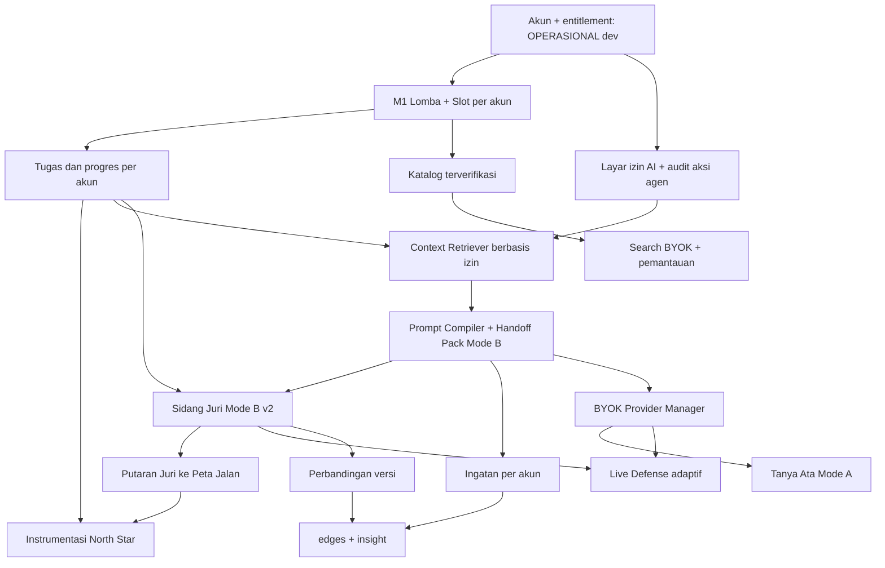

# ATA sebagai Personal Competition Agent: audit dan strategi

Dokumen strategi tambahan. Tidak mengubah kode, skema, dependensi, konfigurasi, environment, akun, atau deployment, dan tidak mengubah keputusan final BYOK, keamanan, dan privasi. Untuk direview Product Owner sebelum ada implementasi lanjutan.

## 0. Dasar audit

| Sumber | Keadaan yang dibaca |
|---|---|
| `ata`, cabang `r005-migrasi-logika` | `a8d7c92` (dasar cabang dokumen ini) |
| `ata`, PR #11 (M1 Lomba, terbuka, belum di-merge) | `870c78e`, sudah memuat PR #12 (`5a70807`) |
| `ata`, PR #13 (gerbang M1 Lomba, terbuka) | `ac416ad` |
| `ata-prototype` | HEAD lokal saat audit, termasuk `docs/blueprint/00`–`16` |

Jalur berkas di bawah mengacu ke `ata` kecuali diawali `ata-prototype/`. Hal yang hanya ada di PR #11/#13 ditandai "(PR #11)".

### Tingkat status

| Label | Arti |
|---|---|
| IDE | Disebut dalam arahan atau diskusi; belum ada spesifikasi tertulis |
| SPESIFIKASI | Tertulis di blueprint atau PRD; belum ada kode |
| PROTOTIPE | Berjalan di `ata-prototype` (HTML/JS + `serve.py`), data di perangkat atau memori server demo |
| IMPLEMENTASI | Ada di app Next.js `ata` |
| TERUJI | IMPLEMENTASI dengan uji otomatis dan/atau uji browser yang lulus |
| OPERASIONAL | Dipakai dengan akun sungguhan terhadap backend sungguhan dan terbukti menyimpan/membaca data |

Tidak ada kemampuan yang OPERASIONAL di produksi: belum ada deployment produksi maupun pembayaran. "OPERASIONAL (dev)" berarti terbukti di `ata-dev` saja.

## 1. Visi dan positioning

**Visi (SPESIFIKASI, `ata-prototype/docs/blueprint/01-prd.md`):** "pusat kendali perkembangan akademik dan kompetisi untuk siswa dan mahasiswa Indonesia."

**Arah (IDE, arahan PO):** "Your Personal Competition Agent". Agen di sini berarti sistem yang mengenal pengguna, merencanakan, menyiapkan draf, dan memeriksa hasil, dengan izin eksplisit untuk setiap tulisan penting dan setiap pengiriman data keluar. Bukan chatbot umum dan bukan agen otonom tanpa persetujuan.

**Positioning:**
- Untuk siswa dan mahasiswa Indonesia yang mengikuti lomba.
- ATA memegang satu rantai utuh: temukan lomba → pilih Slot → Peta Jalan → tugas harian → uji di depan juri → revisi → kirim → rekam jejak.
- Nilai utamanya ada pada konteks pribadi yang terverifikasi dan alur kerja, bukan pada model AI. Model dibawa pengguna (BYOK, Mode A) atau dipakai lewat serah-terima (Mode B).
- Kualitas dirasakan pada interaksi inti (folder Slot, selesai tugas, pindah tab, Detail, Peta Jalan), bukan pada jumlah efek 3D.

**Yang tidak boleh diklaim** (`15-keputusan-final.md`, `14-model-penggunaan-byok.md`): "AI Ata" di Mode B, "skor resmi", "dijamin lolos", "siap menang", hasil pencarian tersambung bila tidak ada Search API pengguna.

## 2. Kemampuan aktual versus blueprint

### 2.1 App Next.js (`ata`)

| Kemampuan | Status | Bukti | Catatan |
|---|---|---|---|
| Akun Google, sesi, profil, paket dari server | OPERASIONAL (dev) | `supabase/migrations/0002`–`0004`, `src/app/api/v1/me/route.ts`, `src/lib/entitlements/config.ts` | Dipakai dengan sesi Google sungguhan di `ata-dev` |
| Layar Masuk, Paket | TERUJI | `src/app/(ata)/(layar)/` | Pembayaran belum ada; paritas visual Masuk belum diulang dengan konfigurasi Google lokal |
| Hari Ini + kerangka lima tab | TERUJI | `src/app/(ata)/(apl)/hari-ini/` | Data tugas, XP, streak di perangkat (localStorage), bukan di akun |
| Lomba: Radar, Tersimpan, Detail, Slot, Peta Jalan | TERUJI (PR #11) | `src/app/(ata)/(apl)/lomba/`, `src/lib/prototype/lomba/` | PR #11 belum di-merge. Katalog adalah data contoh |
| Slot per akun, batas Gratis 1 / Pro 3 lewat trigger, RLS | TERUJI lokal (PR #11) | `supabase/migrations/0005_user_competitions.sql`, `src/app/api/v1/user-competitions/`, `tests/backend/uji-0005-supabase-lokal.sql` (PR #13) | Belum OPERASIONAL: `0005` belum dijalankan di `ata-dev`, API menjawab 503. Pemetaan trigger → HTTP 409 lewat PostgREST belum terverifikasi |
| Skor kecocokan lomba, pencarian/filter, tanggal Peta Jalan | TERUJI (PR #11) | `src/lib/prototype/lomba/logic/` | Deterministik, tanpa AI |
| Pencarian tanpa kunci: kueri siap pakai | TERUJI (PR #11) | Uji browser PR #11 | Tidak ada panggilan ke penyedia pencarian |
| Tabel izin AI per kategori | IMPLEMENTASI | `ai_permissions` di `0002_account_foundation.sql` | Belum ada layar atau alur yang memakainya |
| Log audit akun | IMPLEMENTASI | `audit_log` di `0002`, `src/lib/account/audit.ts` | Cakupan untuk aksi agen belum ada |
| Tanya Ata | Belum ada | `src/app/(fondasi)/(app)/ata/page.tsx` menampilkan "Belum terhubung ke AI." | Logika prototipe sudah disalin ke `src/lib/prototype/tanya/` tetapi tidak dipakai layar mana pun |
| Sidang Juri, Portofolio, Progres | Belum ada | `src/lib/prototype/sidang/`, `src/lib/prototype/portofolio/` hanya salinan logika | Tidak ada rute |
| Orkestrasi AI, Radar server, Roadmap server, Laporan | Belum ada | `src/lib/ai`, `src/lib/radar`, `src/lib/roadmap`, `src/lib/report` hanya berisi `README.md` | |
| Registri penyedia AI | IMPLEMENTASI (data) | `content/providers.json` | Tidak ada kode yang memanggil penyedia |
| Instrumentasi peristiwa/metrik | Belum ada | Tidak ditemukan pelacakan peristiwa di `src/` | North Star belum bisa diukur |

Tabel database yang ada: `system_flags`, `profiles`, `plan_features`, `entitlements`, `redeem_codes`, `redemptions`, `redeem_requests`, `audit_log`, `ai_permissions`, `consents`, dan `user_competitions` (PR #11). Belum ada tabel tugas, tujuan, dokumen, evaluasi, ingatan, keputusan, `workflow_runs`, serah-terima, atau `edges`.

### 2.2 Prototipe (`ata-prototype`)

| Kemampuan | Status | Bukti | Batas |
|---|---|---|---|
| Sambungan AI BYOK (status, simpan, uji, putus, chat) | PROTOTIPE | `serve.py` `/api/ai/*`, `tanya/ai.js` | Kunci di memori server demo; bukan arsitektur produksi |
| Paket konteks dengan anggaran 6.000 token dan urutan pangkas | PROTOTIPE | `tanya/logic/konteks.js` | Sumber konteks adalah data perangkat |
| Penyusun permintaan ke model, tanpa data karangan | PROTOTIPE | `tanya/logic/percakapan.js` | |
| Mesin templat substitusi tanpa `eval` | PROTOTIPE | `tanya/logic/templat.js` | Bukan Prompt IR 14 bagian |
| Resep, Racikan, stepper dengan pratinjau privasi dan salin/tempel | PROTOTIPE | `tanya/logic/resep.js`, `tanya/ui/jalan.js`, `tanya/ui/resep.js` | Bentuk awal serah-terima Mode B |
| Penyaring Ingatan (kredensial, kartu, kesehatan ditolak) | PROTOTIPE | `tanya/logic/ingatan.js` | Ingatan berupa daftar, bukan graf |
| Izin data AI per kategori | PROTOTIPE | `shared/logic/bersama.js` (`KATEGORI_IZIN`) | Lihat kontradiksi K1 |
| Sidang Juri: panel 3–5 juri dari juknis, pertanyaan per kriteria, desakan, skor 1–5 dengan batas atas, waktu 90 detik, riwayat | PROTOTIPE | `sidang/logic/panel.js`, `sidang/sesi.js`, `sidang/logic/waktu.js` | "tanpa AI di belakangnya"; pertanyaan dari templat |
| Jawaban lisan lewat pengenalan suara browser | PROTOTIPE | `sidang/ui/sidang.js` (`SpeechRecognition`) | Bergantung browser; jatuh ke ketik. Tidak ada TTS |
| Perkiraan biaya sesi dengan kunci pengguna | PROTOTIPE | `sidang/logic/biaya.js` | |
| Pencarian lomba Mode A (Tavily/Brave milik pengguna) dan Mode B (strategi kueri) | PROTOTIPE | `serve.py` `/api/cari/config`, `/api/lomba/temukan` | |
| Saran langkah berikutnya | PROTOTIPE | `app/logic/saran.js` | Deterministik |
| Portofolio: sertifikat, laporan bulanan, tautan baca-saja 30 hari | PROTOTIPE | `portofolio/logic/` | |

### 2.3 Hanya SPESIFIKASI

Intent & Task Classifier, Planner, Capability Router dan Registry, Prompt IR 14 bagian, Prompt Quality Gate, Output Validator, panel verifikasi, graf `edges` dengan provenance, insight berbasis bukti (minimal dua edge), rubrik resmi, juri L2 (LLM) dan L3 (mentor), red-team, perbandingan versi, kalibrasi mentor, katalog terverifikasi (K-20), validator berkas, pemantauan lomba. Sumber: `ata-prototype/docs/blueprint/02`, `04`, `05`, `06`, `15`, `16`.

### 2.4 Hanya IDE (belum ada di blueprint yang saya baca)

Live Defense Simulation sebagai mode tersendiri (arena, tingkat kesulitan, TTS, laporan performa), pengendali volume notifikasi proaktif, dan penamaan "Personal Competition Agent".

### 2.5 Kesimpulan audit

App saat ini adalah fondasi akun ditambah dua layar inti (Hari Ini, Lomba). Seluruh lapisan "agen" (konteks, orkestrasi, ingatan, juri) baru berupa prototipe sisi-klien atau spesifikasi. Jarak terbesar bukan UI, melainkan data per akun: tanpa tugas, dokumen, evaluasi, dan ingatan di server, tidak ada yang bisa di-retrieve, diverifikasi, atau diukur.

## 3. Personal Agent Architecture

Lima lapisan. Status menunjukkan keadaan terbaik saat ini.

| Lapisan | Isi | Status |
|---|---|---|
| 1. Identitas dan hak | Akun, profil, paket, izin AI per kategori, persetujuan | OPERASIONAL (dev) untuk akun dan paket; IMPLEMENTASI untuk tabel izin |
| 2. Data pribadi | Profil akademik, tujuan, minat, keahlian dan kelemahan, karya, riwayat lomba, keputusan, aktivitas dan progres, hambatan, prioritas | Slot/Peta Jalan TERUJI lokal (PR #11); sisanya PROTOTIPE di perangkat atau SPESIFIKASI |
| 3. Knowledge Graph | Entitas + `edges` dengan provenance dan rujukan bukti | SPESIFIKASI |
| 4. Orkestrasi | Classifier → Retriever → Planner → Router → Compiler → Quality Gate → Executor → Validator → Verifikasi | PROTOTIPE sebagian (retriever, templat, resep); sisanya SPESIFIKASI |
| 5. Pengalaman | Hari Ini, Lomba, Tanya Ata, Sidang, Progres, Portofolio | Hari Ini dan Lomba TERUJI; sisanya PROTOTIPE |

### Izin agen

Blueprint (`02-orkestrasi-ai.md`) menetapkan lima tingkat. Pemetaan ke istilah arahan:

| Arahan | Blueprint | Aturan |
|---|---|---|
| Read | `read_context` | Hanya kategori yang diizinkan pengguna |
| (cari) | `search` | Hanya dengan Search API pengguna, atau kueri siap pakai |
| Plan | — | Tidak menulis apa pun; hasilnya rencana yang bisa ditolak |
| Draft | `write_draft` | Tersimpan sebagai draf, tidak mengubah data utama |
| Execute | `write_commit`, `external_send` | Konfirmasi di UI untuk setiap tulisan penting; konfirmasi per aksi dan pratinjau konteks untuk setiap pengiriman keluar |
| Verify | Output Validator + panel verifikasi | Kegagalan ditampilkan, tidak disembunyikan |

Usulan (IDE): "Plan" dan "Verify" dijadikan tingkat eksplisit di spesifikasi agar selaras dengan arahan. Ini penambahan nama, bukan perubahan keputusan.

### Jejak audit

Setiap langkah agen mencatat: siapa, niat, kategori data yang dibaca, apa yang dikirim keluar dan ke mana, persetujuan yang diberikan, hasil validasi. Tabel `audit_log` sudah ada untuk akun; perluasannya ke aksi agen adalah SPESIFIKASI. Isi chat dan kunci tidak pernah masuk log (aturan repo).

### Bantuan proaktif

Aturan (SPESIFIKASI + IDE):
- Setiap saran menyebut buktinya (tenggat, tugas terlambat, skor kriteria). Tanpa bukti, tidak ada saran.
- Deterministik lebih dulu (`app/logic/saran.js` sudah begitu), AI hanya bila pengguna punya sambungan.
- Pengendali volume: batas per hari, mode senyap, dan matikan per jenis. Angka batas belum ditetapkan; perlu baseline.

## 4. Intelligent AI Orchestration

Rantai dari `02-orkestrasi-ai.md`:

```text
Permintaan → Intent & Task Classifier → Context Retriever → Planner → Router (model/tool/mode)
→ Prompt Compiler → Prompt Quality Gate → Executor → Output Validator → Hasil + panel verifikasi
→ Umpan balik → Data Progres
```

| Komponen | Status | Yang sudah ada | Yang belum |
|---|---|---|---|
| Intent & Task Classifier | SPESIFIKASI | — | Taksonomi niat; versi deterministik (aturan + pilihan pengguna) lebih dulu |
| Context Retriever | PROTOTIPE | `tanya/logic/konteks.js` | Sumber data server, lingkup izin dari `ai_permissions` |
| Workflow Planner + Task Decomposition | PROTOTIPE sebagian | Resep/Racikan sebagai rencana tetap | Rencana dinamis, `workflow_runs` |
| Capability Router | SPESIFIKASI | `content/providers.json` sebagai data | Registry kemampuan terverifikasi (keputusan terbuka di `13`) |
| Prompt Compiler | PROTOTIPE sebagian | `tanya/logic/templat.js`, `percakapan.js` | Prompt IR 14 bagian |
| Prompt Quality Gate | SPESIFIKASI | — | Pemeriksaan kelengkapan IR sebelum eksekusi |
| Executor | PROTOTIPE | `serve.py` `/api/ai/chat`; salin/tempel di `tanya/ui/jalan.js` | Rute server app, penyimpanan kunci sesuai K-15 |
| Output Validator | SPESIFIKASI | `tanya/logic/markdown.js` hanya mengamankan tampilan | Validasi struktur, rujukan bukti, larangan klaim |
| Verification Engine | SPESIFIKASI | — | Lihat di bawah |

**Verification Engine** adalah bagian yang membuat "maju secara terverifikasi" bisa dihitung. Tiga jenis bukti, dari yang termurah:
1. Deterministik: tugas ditandai selesai dengan tanggal lokal, berkas lolos validator, tenggat cocok dengan sumber.
2. Rubrik: skor naik pada rubrik yang sama antar versi.
3. Pernyataan pengguna: pengiriman lomba dikonfirmasi, dengan bukti opsional.

**Mode.** Mode A memakai sambungan pengguna. Mode B menghasilkan Handoff Pack dan menunggu hasil ditempel kembali (draf → disalin → menunggu → kembali → divalidasi → direvisi). Rantai di atas harus berjalan penuh di Mode B tanpa satu pun panggilan AI dari platform. Tidak ada fallback kredensial.

**Keamanan.** Konten eksternal (poster, PDF, hasil pencarian, hasil tempel) adalah data, bukan instruksi.

## 5. Personal Memory dan Knowledge Graph

Model dari `06-data-progres.md`: entitas (profil, tujuan, keahlian dan sinyalnya, tugas, proyek, lomba dan lomba pengguna, dokumen/versi, prestasi, evaluasi, umpan balik, aktivitas belajar, `workflow_runs`, serah-terima, keputusan, ingatan) dihubungkan oleh `edges` generik dengan provenance dan rujukan bukti.

| Bagian | Status |
|---|---|
| Lomba pengguna (Slot, tersimpan, dilewati, Peta Jalan) | TERUJI lokal (PR #11), satu tabel dengan JSON |
| Profil dasar | OPERASIONAL (dev) |
| Tugas, XP, streak | PROTOTIPE/TERUJI di perangkat; belum per akun |
| Ingatan dengan penyaring data sensitif | PROTOTIPE |
| Tujuan, keahlian, keputusan, dokumen, evaluasi, `edges` | SPESIFIKASI |

Prinsip yang dipertahankan:
- Setiap ingatan punya sumber, waktu, dan bisa dilihat, diubah, dihapus, dan diekspor pengguna.
- Ingatan diusulkan, pengguna menyetujui. Tidak ada penyimpanan diam-diam.
- Insight butuh minimal dua edge pendukung.
- Tidak ada pembelajaran lintas pengguna dari isi pribadi.
- Retrieval deterministik dengan anggaran token.

Usulan urutan (IDE): mulai dari tabel relasional per entitas yang paling sering dibaca (tugas, evaluasi, ingatan), baru tambah `edges`. Graf penuh sejak awal berisiko mahal sebelum ada data untuk diisi.

**Ukuran "ingatan berguna":** proporsi ingatan yang ikut dalam paket konteks lalu tidak dihapus atau dikoreksi pengguna, dan proporsi ingatan yang pernah dipakai sama sekali.

## 6. Advanced Jury Experience

### 6.1 Evaluasi tiga lapis (`15-keputusan-final.md`)

| Lapis | Isi | Status |
|---|---|---|
| L1 | Validasi deterministik (format, kelengkapan, batas) | SPESIFIKASI; batas skor tanpa bukti sudah ada di PROTOTIPE |
| L2 | Evaluasi rubrik oleh LLM lewat sambungan atau aplikasi pengguna | SPESIFIKASI |
| L3 | Tinjauan mentor manusia | SPESIFIKASI |

### 6.2 Komponen

| Komponen | Status | Catatan |
|---|---|---|
| Ingest rubrik resmi | SPESIFIKASI | Rubrik resmi PKM masih keputusan terbuka (`13`) |
| Rubrik internal per kategori, berlabel "internal" | PROTOTIPE sebagian | Sudut pertanyaan per kategori di `sidang/sesi.js` |
| Persona: reviewer akademik, juri bisnis, venture, produk/inovasi, evaluator nasional dan internasional, juri pitch | SPESIFIKASI; PROTOTIPE untuk karakter juri di `sidang/data/juri.js` | Tidak meniru juri sungguhan |
| Panel multi-perspektif | PROTOTIPE (deterministik) | Bila satu model memerankan semua juri, itu diungkapkan |
| Red-team | SPESIFIKASI | |
| Validasi bukti, setiap kelemahan punya lokasi dan bukti | SPESIFIKASI; desakan saat jawaban tanpa bukti sudah PROTOTIPE | |
| Hard-fail dan batas atas deterministik | PROTOTIPE sebagian | "klaim tanpa angka/sumber tidak bisa lebih dari 2" |
| Perbandingan versi | SPESIFIKASI | Butuh penyimpanan versi dokumen |
| Kalibrasi mentor | SPESIFIKASI | R4 |

### 6.3 Live Defense Simulation

Alur: pilih arena/kategori → tingkat kesulitan → panel persona → pitch → pertanyaan adaptif dan lanjutan → uji substansi, asumsi, dan hitungan → debrief → laporan performa → rencana perbaikan → ulang setelah revisi.

| Bagian | Status | Kelayakan |
|---|---|---|
| Sesi berwaktu (90 detik per pertanyaan, tidak memotong) | PROTOTIPE | Layak sekarang; tanpa biaya |
| Pertanyaan dan desakan dari templat | PROTOTIPE | Layak sekarang; tidak benar-benar adaptif |
| Pertanyaan adaptif dari isi jawaban | IDE | Butuh Mode A. Di Mode B hanya bisa per putaran lewat salin/tempel, tidak "langsung" |
| Pemilihan arena dan kesulitan | IDE | Layak; deterministik (jumlah desakan, waktu, ketat batas skor) |
| STT | PROTOTIPE | Web Speech API tidak tersedia merata di semua browser dan di sebagian browser audio diproses layanan milik vendor browser. Perlu keputusan privasi sebelum dijadikan fitur; ketik tetap jalur utama |
| TTS | IDE | `speechSynthesis` browser gratis tetapi mutu suara Indonesia bergantung perangkat; belum diuji. TTS berbayar (mis. ElevenLabs) butuh persetujuan biaya |
| Laporan performa dan rencana perbaikan | PROTOTIPE sebagian (ringkasan dan riwayat) | Layak; lihat bagian 7 |

**Batas keselamatan (tidak bisa ditawar):**
- Selalu berlabel simulasi, bukan penilaian resmi.
- Tidak meniru juri sungguhan.
- Tidak menjanjikan menang.
- Tidak ada klaim objektif tentang kondisi psikologis, emosi, atau intonasi. Yang boleh dilaporkan hanya yang terukur: durasi, jumlah jawaban melewati waktu, ada/tidaknya angka dan sumber.

## 7. Integrasi Juri dengan Peta Jalan dan Data Progres

Satu putaran (SPESIFIKASI/IDE; belum ada yang terhubung):

1. Sidang menghasilkan temuan per kriteria, masing-masing dengan lokasi dan bukti.
2. Temuan diusulkan sebagai langkah Peta Jalan (draf). Pengguna menyetujui satu per satu; tidak ada penulisan otomatis.
3. Langkah yang disetujui muncul di Hari Ini.
4. Setelah revisi, Sidang diulang dengan rubrik dan panel yang sama.
5. Selisih skor per kriteria dicatat sebagai evaluasi baru dan menjadi satu unit North Star bila naik.
6. Personalisasi hanya mengubah rencana perbaikan, tidak mengubah skor (`05-juri.md`).

Yang sudah ada: tugas yang dicentang di Peta Jalan tampil di Hari Ini (TERUJI, PR #11). Yang belum: riwayat Sidang masih di `localStorage` prototipe dan tidak terhubung ke Peta Jalan.

## 8. Competition Intelligence

| Kemampuan | Status | Catatan |
|---|---|---|
| Katalog contoh berlabel DATA DEMO | TERUJI | |
| Entri manual / dari URL atau juknis | PROTOTIPE (`lomba/logic/manual.js`) | |
| Skor kecocokan deterministik dan bisa dijelaskan; popularitas bukan faktor | TERUJI (PR #11) | |
| Mode B: kueri siap pakai | TERUJI (PR #11) | |
| Mode A: Search API pengguna | PROTOTIPE | R2.3 |
| Katalog terverifikasi (K-20) dengan provenance dan `last_checked_at` | SPESIFIKASI | Butuh proses kurasi, bukan hanya kode |
| Konflik sumber ditampilkan, tidak diselesaikan diam-diam | SPESIFIKASI | |
| Deduplikasi | SPESIFIKASI | |
| Pemantauan perubahan tenggat | SPESIFIKASI | Tidak boleh diklaim tanpa Search API |

Aturan tetap: hormati robots.txt, ToS, dan batas laju; tidak pernah meminta login Instagram.

Ukuran: kesegaran = umur `last_checked_at` saat lomba ditampilkan; akurasi tenggat = sampel yang dicek manual terhadap sumber resmi; duplikat = pasangan yang digabung pengguna atau kurator per jumlah entri.

## 9. Unified User Experience

- **Satu objek kerja:** Slot. Hari Ini, Peta Jalan, Sidang, dan Tanya Ata semuanya berangkat dari Slot yang sama.
- **Satu bahasa status** di semua layar untuk serah-terima: draf, disalin, "Menunggu hasil dari {aplikasi}", kembali, divalidasi, direvisi.
- **Sumber selalu terlihat:** setiap saran, skor, dan data lomba menunjukkan asalnya dan kapan terakhir dicek.
- **Persetujuan di tempat:** pratinjau konteks sebelum data keluar; konfirmasi sebelum tulisan penting.
- **Empat keadaan** di setiap layar: memuat, kosong, galat, belum masuk.
- **Kualitas interaksi sebagai kriteria terima,** bukan polesan akhir: fokus masuk dan kembali, Escape, gerak dikurangi tetap berfungsi, kontras 4,5:1 diukur dari piksel, tanpa luapan horizontal, 390 dan 1280 px, terang dan gelap. Ini sudah dijalankan untuk Hari Ini dan Lomba.
- **Efek 3D** hanya bila menjelaskan keadaan atau hierarki. Cinema dan Study Room tetap pekerjaan pemulihan terpisah.
- **Prototipe dulu:** perubahan visual dan interaksi masuk ke `ata-prototype`, lalu disalin ke app.

## 10. Competitive moat

Yang bisa menjadi pembeda, dengan status jujur:

| Moat | Mengapa sulit ditiru | Status |
|---|---|---|
| Rekam kerja terverifikasi per pengguna | Terkumpul seiring waktu; tidak bisa disalin dari luar | Belum ada (data masih di perangkat) |
| Juri berbasis rubrik dan bukti dengan putaran revisi | Butuh rubrik, batas deterministik, dan riwayat versi | PROTOTIPE sebagian |
| Katalog lomba Indonesia dengan provenance | Kerja kurasi berkelanjutan | SPESIFIKASI |
| Bernilai tanpa kunci API (Mode B) | Menuntut desain alur, bukan sekadar akses model | PROTOTIPE sebagian |
| Kepercayaan: BYOK, tanpa fallback tersembunyi, izin per kategori | Keputusan produk yang mengikat | Keputusan final; implementasi sebagian |
| Kualitas interaksi | Disiplin prototipe-dulu dan uji paritas | TERUJI untuk dua layar |

Yang bukan moat: model AI, efek visual, dan jumlah fitur.

## 11. Prioritas

**P0: fondasi yang membuat "agen" mungkin dan terukur**
1. Selesaikan M1 Lomba: merge PR #11/#13 setelah review, jalankan `0005` di `ata-dev` setelah disetujui, verifikasi persistensi Slot dan 409 di backend sungguhan.
2. Data per akun untuk tugas, XP/streak, dan progres (saat ini di perangkat).
3. Instrumentasi peristiwa minimal untuk North Star, tanpa isi chat, kunci, atau isi dokumen.
4. Prompt Compiler deterministik + Handoff Pack Mode B (R1.1) dengan Context Retriever berbasis izin.
5. Sidang Juri Mode B v2 (R1.3): rubrik internal berlabel, bukti wajib, batas deterministik, riwayat per akun.
6. Putaran Juri → Peta Jalan → Hari Ini → ulang Sidang.
7. Layar izin AI yang memakai `ai_permissions` dan jejak audit aksi agen.

**P1: memperdalam**
- Ingatan per akun (usul, setujui, lihat, hapus, ekspor).
- Lomba tanpa Search API: katalog terverifikasi, entri manual/URL, provenance (R1.4).
- Validator berkas (R1.5).
- BYOK Provider Manager dan Tanya Ata Mode A (R2.1, R2.2).
- Live Defense: arena, kesulitan, laporan performa; pertanyaan adaptif di Mode A.
- Perbandingan versi.

**P2: memperluas**
- `edges` dan insight berbasis bukti.
- Search BYOK dan pemantauan (R2.3).
- Red-team, kalibrasi mentor, L3 (R4).
- TTS, bila diputuskan.
- Bantuan proaktif dengan pengendali volume.
- Pembayaran dan deployment produksi (R3) mengikuti keputusan terpisah.

## 12. Dependency graph dan kriteria terima



| Butir | Kriteria terima |
|---|---|
| M1 Lomba | Slot tersimpan dan terbaca ulang per akun di `ata-dev`; Slot kedua akun Gratis ditolak dengan 409 lewat API; turun paket tidak menghapus atau mengarsipkan Slot; akun lain melihat nol baris |
| Tugas/progres per akun | Tanggal selesai, XP, dan streak sama di dua perangkat; satu mekanisme tanggal lokal; uji lewat tengah malam lulus; RLS diuji |
| Instrumentasi | Setiap unit North Star punya peristiwa dengan definisi tertulis; tidak ada isi chat, kunci, atau isi dokumen di peristiwa; bisa dimatikan pengguna bila diwajibkan keputusan privasi |
| Izin dan audit | Kategori yang dimatikan tidak pernah muncul di paket konteks (uji otomatis); setiap pengiriman keluar punya entri audit dan konfirmasi |
| Compiler + Handoff | Keluaran identik untuk masukan identik; 14 bagian IR terisi atau ditandai kosong dengan alasan; tidak ada panggilan jaringan ke penyedia AI di Mode B; label status serah-terima sesuai `14` |
| Sidang v2 | Setiap kelemahan punya lokasi dan bukti; rubrik internal berlabel; label simulasi di setiap layar hasil; skor identik untuk jawaban identik (lapis deterministik) |
| Putaran Juri → Peta Jalan | Tidak ada langkah yang ditulis tanpa persetujuan; sidang ulang memakai rubrik yang sama; selisih per kriteria tersimpan |
| Ingatan | Data sensitif ditolak (uji); lihat, ubah, hapus, ekspor berfungsi; hapus benar-benar menghapus |
| BYOK | Sesuai K-15; kunci tidak pernah di log, analitik, atau respons klien; tidak ada kredensial platform |
| Live Defense | Tanpa klaim emosi/intonasi; ketik selalu tersedia; di Mode B tidak disebut "langsung" |
| Semua layar | typecheck, lint, unit, e2e, build; paritas 390/1280 terang/gelap; gerak dan transparansi dikurangi; empat keadaan |

## 13. Roadmap implementasi

Mengikuti `13-roadmap-risiko-keputusan.md`; dokumen ini tidak mengubah urutannya, hanya menempatkan butir agen di dalamnya. Tanpa tanggal: belum ada baseline kecepatan untuk tahap-tahap ini.

| Tahap | Isi | Butir agen |
|---|---|---|
| R0.2 (berjalan) | Data dan layar M1 | M1 Lomba, tugas/progres per akun, instrumentasi, sisa layar (Progres, Profil) |
| R1.1 | Prompt Compiler deterministik | Retriever berbasis izin, Handoff Pack, layar izin, audit |
| R1.2 | Capability Registry | Router |
| R1.3 | Juri Mode B v2 | Sidang v2, putaran ke Peta Jalan, Live Defense deterministik |
| R1.4 | Lomba tanpa Search API | Katalog terverifikasi, provenance |
| R1.5 | Validator berkas | Lapis L1, Verification Engine |
| R1.6 | Layar tersisa | Ingatan, Portofolio |
| R2.1–R2.3 | BYOK, Tanya Ata Mode A, Search BYOK | Classifier dan Planner dinamis, Live Defense adaptif, pemantauan |
| R3 | Pembayaran, deployment | — |
| R4 | Mentor, NotebookLM Enterprise, multi-model | L3, kalibrasi, red-team lintas model |

## 14. Metrik keberhasilan

**North Star:** jumlah pekerjaan kompetisi yang maju secara terverifikasi per pengguna aktif per minggu. Satu unit = tugas Peta Jalan selesai, atau revisi yang menaikkan skor pada rubrik yang sama, atau pengiriman lomba yang dikonfirmasi pengguna.

Tidak ada target angka di dokumen ini. Belum ada instrumentasi, jadi belum ada baseline. Target di blueprint adalah hipotesis sampai baseline terukur.

| Metrik | Cara ukur | Bisa diukur sekarang? |
|---|---|---|
| Aktivasi | Akun baru yang memilih Slot pertama dan menyelesaikan satu tugas dalam jendela waktu tetap | Tidak |
| Penyelesaian alur kerja | `workflow_runs` selesai / dimulai | Tidak |
| Keberhasilan prompt | Keluaran lolos Output Validator pada percobaan pertama | Tidak |
| Keberhasilan eksekusi tool | Panggilan sukses / total, per penyedia | Tidak |
| Tingkat ulang | Jalankan ulang per langkah | Tidak |
| Serah-terima kembali | Handoff berstatus "kembali" / "disalin" | Tidak |
| Konsistensi juri | Selisih skor pada masukan identik; untuk L2, sebaran antar pengulangan | Lapis deterministik bisa diuji di prototipe |
| Cakupan bukti | Temuan dengan lokasi dan bukti / total temuan | Tidak |
| Perbaikan setelah revisi | Selisih skor per kriteria, rubrik sama | Tidak |
| Pengiriman lomba | Konfirmasi pengguna per Slot | Tidak |
| Retensi | Pengguna aktif minggu N yang aktif lagi di N+1, N+4 | Tidak |
| Kegunaan ingatan | Lihat bagian 5 | Tidak |
| Penerimaan rekomendasi | Saran yang diikuti / ditampilkan | Tidak |
| Kesegaran, akurasi tenggat, duplikat | Lihat bagian 8 | Tidak |
| Biaya infrastruktur | Tagihan penyedia per pengguna aktif | Sebagian (masih tier gratis) |
| Mode A vs Mode B | Proporsi alur per mode; tanpa mencatat isi | Tidak |

## 15. Kontradiksi dan keputusan yang perlu PO

Tidak saya selesaikan sendiri.

| # | Temuan | Sumber | Yang perlu diputuskan |
|---|---|---|---|
| K1 | Izin data AI: prototipe 6 kategori (`profil, slot, tugas, progres, ingatan, lomba`), semuanya menyala sejak awal. Database 8 kategori (`profil, akademik, lomba, tugas, progres, evaluasi, ingatan, dokumen`), semuanya mati sejak awal | `ata-prototype/shared/logic/bersama.js`; `supabase/migrations/0002_account_foundation.sql` | Daftar kategori dan nilai awal. Ini keputusan privasi |
| K2 | Rantai orkestrasi di PRD tidak menyebut Planner dan Quality Gate; dokumen orkestrasi menyebutnya | `01-prd.md`, `02-orkestrasi-ai.md` | Menurut saya `02` yang lebih rinci berlaku; mohon konfirmasi |
| K3 | "Personal Competition Agent" versus visi PRD "pusat kendali perkembangan akademik dan kompetisi" | Arahan PO; `01-prd.md` | Apakah PRD diperbarui, dan apakah lingkup akademik non-lomba tetap |
| K4 | Tingkat izin arahan (Read, Plan, Draft, Execute, Verify) tidak sama dengan blueprint (`read_context, search, write_draft, write_commit, external_send`) | Arahan PO; `02-orkestrasi-ai.md` | Pemetaan di bagian 3 |
| K5 | `docs/STATUS.md` masih berjudul "tahap PROTOTIPE DESAIN", terakhir diperbarui 17 November | `docs/STATUS.md` | Perbarui kepala dokumen pada PR berikutnya |
| K6 | STT browser dapat mengirim audio ke layanan vendor browser | `sidang/ui/sidang.js` | Apakah perlu pemberitahuan atau persetujuan sebelum mikrofon dipakai |
| K7 | Keputusan terbuka di blueprint yang menghalangi butir agen: ToS penyedia, KMS/TTL kunci, rubrik resmi PKM, OCR, verifikasi Capability Registry, persetujuan wali, anggaran infrastruktur, tier Vercel | `13-roadmap-risiko-keputusan.md` | Per butir |
| K8 | Instrumentasi metrik menyentuh privasi dan mungkin butuh layanan | — | Alat, data yang boleh dicatat, dan persetujuan pengguna |

## 16. Batas audit ini

- Blueprint `03`, `07`–`12` tidak dibaca rinci; bagian yang bergantung padanya mungkin kurang lengkap.
- Status prototipe dinilai dari membaca kode dan komentar berkas, bukan dari menjalankan ulang setiap fitur dalam audit ini.
- "Belum ada" untuk instrumentasi berdasarkan pencarian teks di `src/`, bukan audit menyeluruh.
- Perilaku STT/TTS antar browser tidak diuji; pernyataan kelayakan suara adalah penilaian, bukan hasil ukur.
